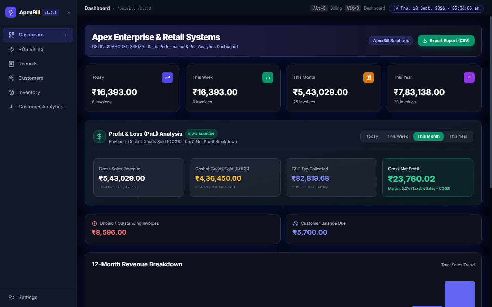
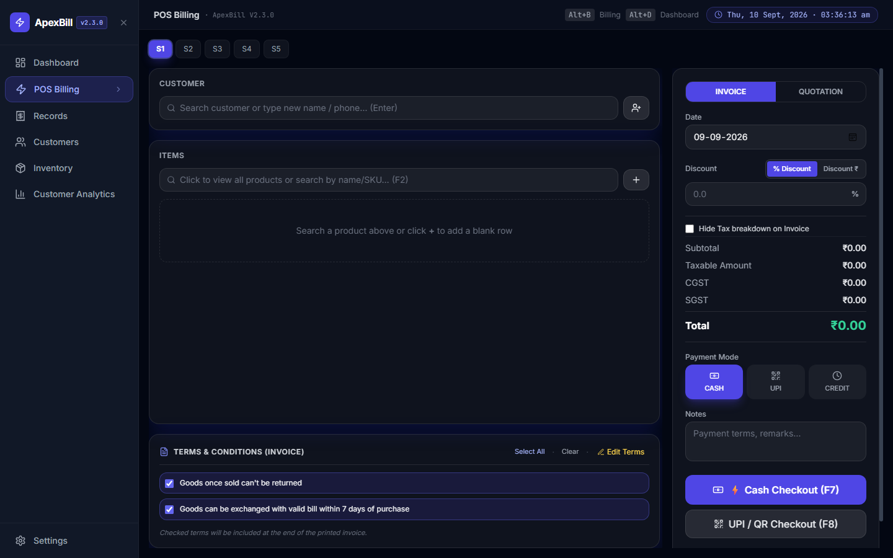
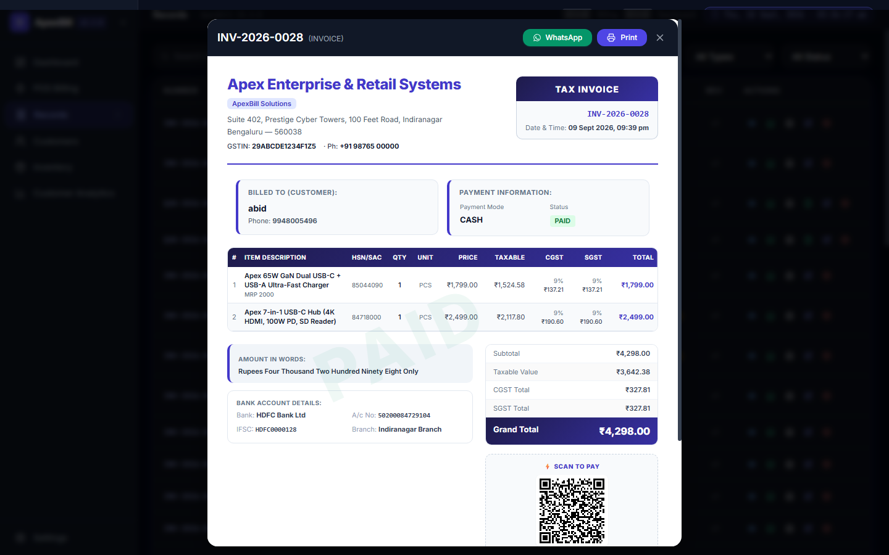
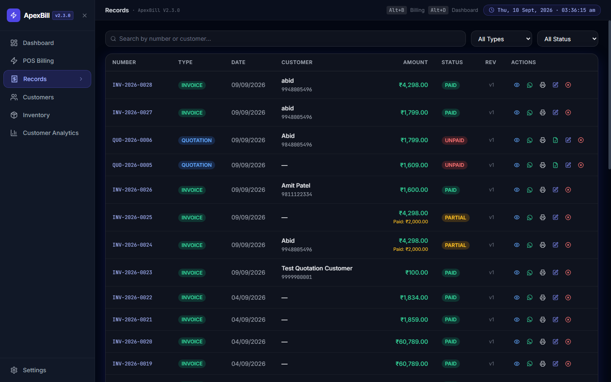
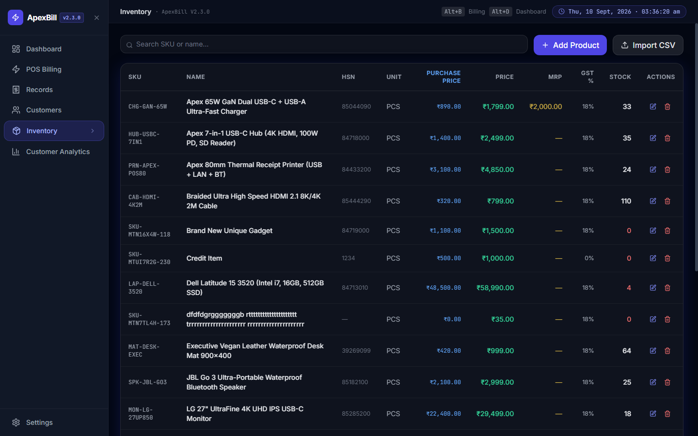
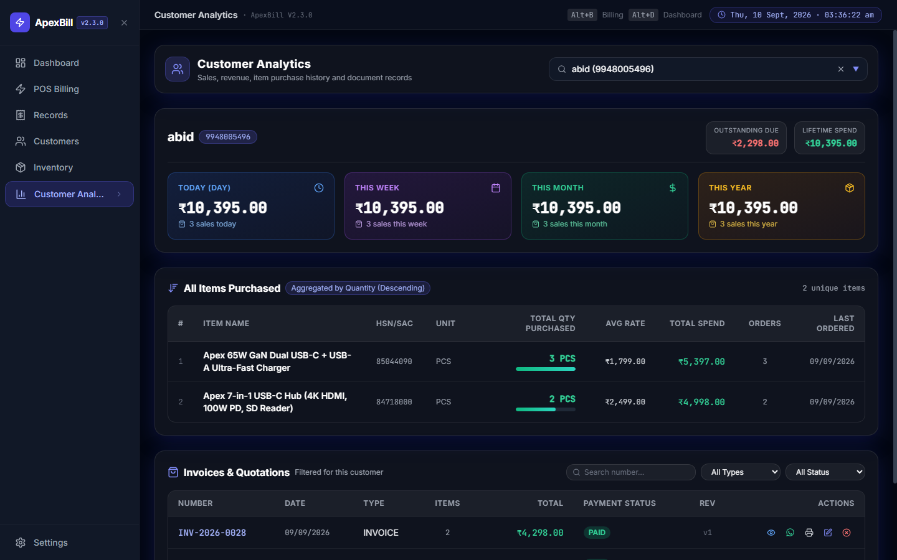
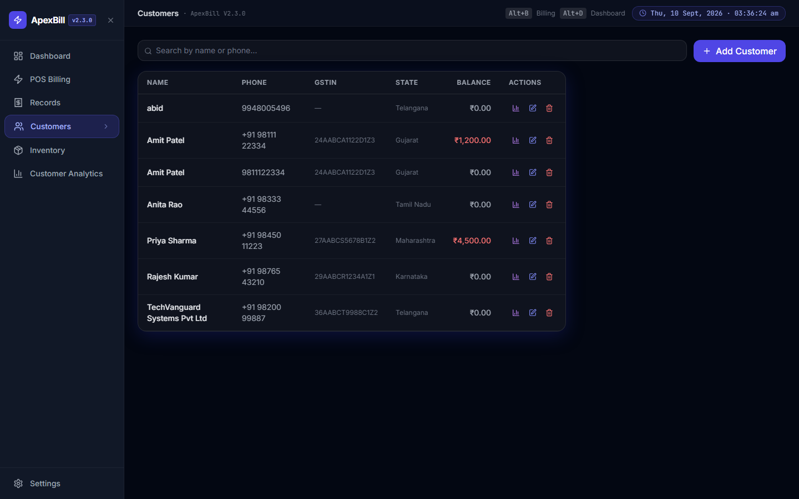
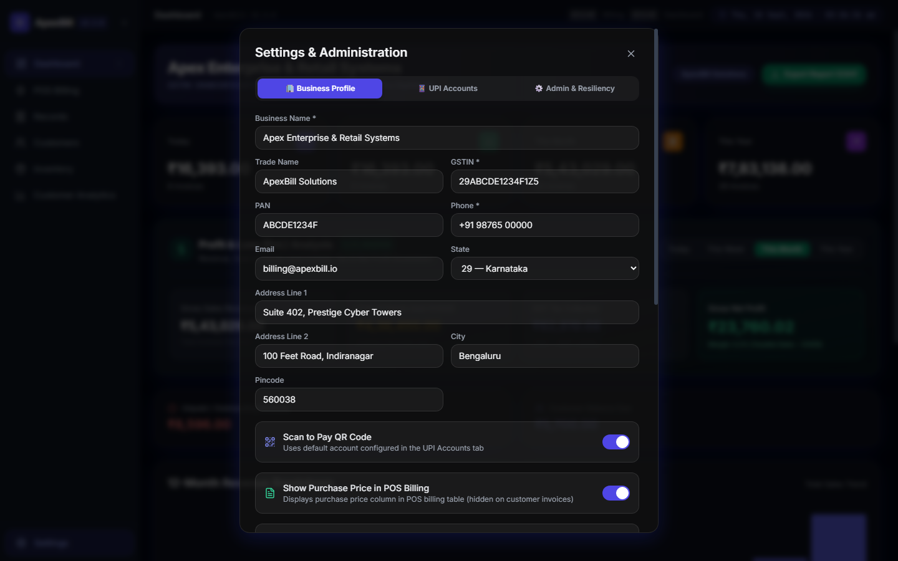

# ApexBill — Modern Billing, POS & Inventory Management System

<p align="center">
  
</p>

<p align="center">
  <strong>An offline-first, high-performance billing, POS, and sales intelligence platform built for modern retail, wholesale, and service businesses.</strong>
</p>

<p align="center">
  
  
  
  
  
  
</p>

---

## 🌟 Key Capabilities & Features

### ⚡ 1. Ultra-Fast POS Billing Workspace
- **Multi-Seller Profile Switcher**: Switch the active Seller GST Profile on the fly directly from the top-bar dropdown; active seller selection is remembered per memory slot and populates all tax, address, bank, and UPI details.
- **5 Concurrent Memory Slots (`Alt+1..5`)**: Switch and hold multiple customer carts simultaneously without data loss or UI slowdown.
- **High-Speed Keyboard Navigation**: Complete entire billing workflows using keyboard hotkeys (`F2` search, `F4` quotation, `F7` cash, `F8` UPI QR).
- **Live SKU & Barcode Search**: Instant product lookup with keyboard arrow navigation and quick auto-fill.
- **Credit Invoicing & Partial Payments**: Customer-tied Credit mode (registered users only) with support for partial upfront payments via Cash or UPI, aggregate paid amounts tracking, and live remaining balance due calculation.
- **Intelligent Mode Locking & Delta Collection**: Settled invoices automatically lock payment modes when total is unchanged. If total increases, payment modes re-enable specifically for the extra/delta amount.
- **Delta vs. Full QR Generation**: When updating Cash or UPI invoices with changed totals, an in-POS toggle generates QR codes for the delta amount (default) or the full amount.
- **1-Click Cancel Edit**: Dedicated discard button beside the editing banner to quickly exit invoice editing without saving accidental changes.
- **Independent Pricing & MRP**: Uses active `Price` for billing, discounts, and PnL while `MRP` is displayed informatively below the description.
- **Dual Discount Engine (`%` and `₹`)**: Apply percentage discounts or fixed currency amounts (rendered as "Additional discount"), protected by automatic loss prevention. Flat ₹ discounts deduct from Grand Total and recalculate overall invoice taxes without modifying individual item unit prices.
- **Hide Tax Breakdown & Conditional Price Hiding**: Side panel checkbox to hide tax breakdown on invoices, with a conditional "Hide price in invoice" checkbox (shown only when tax is hidden) to omit line-item prices and row totals on delivery slips and quotes.
- **Loss Prevention Safeguards**: Validates bills in real time to prevent discounts from causing the grand total to fall below purchase cost.
- **Purchase Price & Margin Protection**: Inline purchase price indicator (`Pur. Price` in blue) with alert highlighting if selling price falls below cost.
- **Stock-Limit Safeguards**: Proactive stock quantity checking with an executive confirmation dialog to either cap or bypass limits.
- **Backdated Invoices & Custom Invoice Numbering**: Enter custom invoice numbers for historical transactions with exact document date and time (`doc_time`) control, seamlessly persisting custom invoice numbers without sequence clashes.
- **Quotation Number Integrity**: Quotation numbers are strictly locked to automated sequence generation, preventing manual overrides while preserving full quotation-to-invoice conversion workflows.
- **Live Estimated Bill Profit**: See live taxable margin and gross profit for every bill before finalizing.
- **Quick Product Modal (`Alt+N`)**: Add brand-new inventory items directly from the checkout table without leaving the POS screen.

### 👥 2. Customer Analytics & Lifetime Intelligence
- **Multi-Timeframe KPI Summary**: Instant sales count and revenue performance across *Today*, *This Week*, *This Month*, *This Year*, and *All-Time*.
- **Aggregated Purchase Insights**: All items purchased by the customer sorted by total quantity in descending order with spend totals.
- **Filtered Document History**: Dedicated register of all customer invoices and quotations with full action parity (View, Print, WhatsApp Share, Convert to Invoice, Edit, Cancel).
- **Direct Directory Shortcuts**: Jump directly to customer analytics with a single click from the Customers Directory.
- **Opaque Autocomplete Combobox**: Fast, distraction-free customer search with phone, name, and credit indicators.

### 📊 3. Executive Sales & PnL Analytics Dashboard
- **Seller Profile PnL Filter**: Inspect metrics for a specific Seller GST Profile or view combined performance across all profiles (`ALL` default mode).
- **Real-Time Revenue Metrics**: Instant KPI summary cards for *Today*, *This Week*, *This Month*, and *This Year*.
- **Profit & Loss (PnL) Engine**: Automatic breakdown of *Gross Revenue*, *Cost of Goods Sold (COGS)*, *GST Tax Liability*, and *Gross Net Profit* with dynamic margin percentage.
- **12-Month Sales Trend Breakdown**: Interactive monthly sales chart to track seasonal trends and business growth.
- **Customer Spend Drill-down**: Click on metrics to inspect ranked customer spending breakdowns.
- **CSV Sales Report Export**: 1-click export of financial reports for accounting and audit compliance.

### 🧾 4. Executive Invoice & Thermal Receipt Layouts
- **Immutable Seller Snapshot**: Invoices and quotations freeze the active seller's business name, GSTIN, address, bank, and UPI details at creation time, guaranteeing audit immutability.
- **Zero-Blank-Page A4 GST Tax Invoice**: Clean typography, structured seller/buyer info, itemized HSN table, CGST/SGST split, bank details, authorized signatory, dynamic UPI QR code, and zero extra trailing blank pages.
- **Dedicated Discount Column & Price/Total Hiding**: Standalone "Disc." column placed before price displaying merged % savings off MRP. When "Hide price in invoice" is toggled, Price and Row Total columns are seamlessly omitted and the Item Description auto-expands across 100% table width while overall summary totals remain intact.
- **Multi-Payment Audit Trail**: Transparent breakdown of all historical partial payments with exact transaction timestamps, payment modes (Cash / UPI), cumulative total paid, and outstanding balance due.
- **Context-Aware Dynamic QR**: Generates dynamic UPI QR codes customized for the remaining balance due or installment amount with clear payment instructions.
- **Native WhatsApp PDF Sharing**: Share generated A4 PDF documents directly with customers via native Windows WhatsApp with custom messages.
- **80mm ESC/POS Thermal Receipts**: Streamlined thermal layout for retail counters and high-traffic POS environments.
- **Quotation / Estimate Support (`F4`)**: Issue professional quotes with auto-saved customer records, validity notes, and 1-click tax invoice conversion.

### 📱 5. Dynamic NPCI UPI QR Engine
- **Instant Scan-to-Pay**: Generates standard NPCI-compliant UPI deep links (`upi://pay?pa=...&pn=...&am=...&tn=...`) rendered on screen and printed invoices.
- **Multi-UPI Accounts Manager**: Configure multiple merchant handles (e.g., HDFC, ICICI, SBI) and set active default accounts.
- **Instant QR Verification**: Works with PhonePe, Google Pay, Paytm, BHIM, and all banking UPI apps.

### 🔄 6. Records Management & Atomic Stock Reconciler
- **Seller Profile Filter**: Filter historical records by Seller GST Profile or browse all transactions combined.
- **Unified Register**: Search and filter past invoices and quotations by type, date range, customer, or payment status.
- **Dedicated Pending Balance Tracker**: View outstanding credit balances for invoices directly in the main records register table.
- **Atomic Stock Restoration**: Editing a historical invoice automatically restocks old items, validates new stock levels, recalculates tax totals, and increments revision numbers (`v1` → `v2`).
- **1-Click Quotation Conversion**: Convert any quotation directly into an active invoice without retyping line items.
- **Invoice Cancellation**: Void invoices with automatic inventory replenishment.

### 📦 7. Inventory & SKU Management
- **Multi-Unit Product Catalog**: Support for `PCS`, `KG`, `LTR`, `MTR`, `BOX`, `PKT`, `NOS`, `SET`, `PAIR`, `DOZ`, and custom units.
- **Dedicated Price vs. MRP Columns**: Clear distinction between calculated selling price and packaging MRP.
- **Stock Health Indicators**: Visual status tags for *In Stock*, *Low Stock*, and *Out of Stock*.
- **High-Speed CSV Bulk Importer**: Upload 2,000+ SKUs with pricing, HSN codes, and initial stock quantities in under 1.5 seconds.

### 👥 8. Customer Directory & Ledger
- **Shared Across All Profiles**: Customer database, credit balances, and transaction history are seamlessly shared across all seller entities.
- **Phone-Number-Indexed Master**: Fast lookup by customer phone number, name, or GSTIN.
- **Automatic Registration**: Adding a customer during billing OR quotation creation automatically saves them to the master database.
- **Outstanding Balance Tracker**: Monitor customer credit, pending dues, and payment history.
- **Analytics Shortcut**: Direct icon button next to every customer to view their complete analytics profile.

### ⚙️ 9. Administration & Data Resiliency
- **Multi-Seller GST Profiles**: Manage multiple business profiles with individual Business Names, Trade Names, GSTINs, PANs, Phone, Email, Addresses, linked Bank Accounts, and default UPIs.
- **Saved Bank Accounts Manager**: Centralized bank account management (Bank Name, Account Number, IFSC, Branch, Account Holder) selectable across profiles.
- **Global Store & POS Settings**: Configure store-wide invoice and quotation terms & conditions, scan-to-pay toggles, POS price display, and stock validation rules.
- **Universal In-App Styled Dialog System**: Replaced intrusive browser-native popups (`confirm()`, `alert()`) with beautiful dark glassmorphism modal dialogs featuring keyboard bindings (`Enter` to confirm, `Esc` to cancel).
- **Global Zero-Latency Startup Preloader**: Centralized asynchronous preloader (`useDataStore`) initializes foundational datasets (seller profiles, inventory, customers, hold slots, and numbering sequences) concurrently at app boot with dual-layer caching (reactive Zustand store + `localStorage`), eliminating cold-start delays across all tabs.
- **Zero-Downtime Hot-Swap Dev Orchestration**: Optimized `dev.ps1` builds client and server in the background while the existing server handles requests, swapping the server process in < 300ms upon completion.
- **1-Click JSON Backup & Restore**: Export full database snapshots for offsite archival and restore seamlessly.

---

## 📸 Application Screenshots

### 1. Sales Performance & PnL Analytics Dashboard
Monitor daily turnover, gross revenue, cost of goods, GST liability, and net profit margins in real time.


---

### 2. POS Billing Workspace (5-Slot Multi-Cart)
High-speed checkout with 5 hold slots, live SKU search, purchase price protection, customer auto-complete, and instant GST calculation.


---

### 3. Executive A4 GST Invoice & Quotation Preview
Clean, high-impact A4 tax invoice template featuring itemized GST breakdown, bank payment info, zero blank pages, and dynamic NPCI QR code.


---

### 4. Records & Document History
Filter and manage historical invoices, share via WhatsApp, track revision numbers, void transactions, or convert quotations to tax invoices.


---

### 5. Inventory & Multi-Unit Catalog
Track stock quantities, HSN/SAC codes, distinct Price vs. MRP columns, profit margins, and tax rates with batch CSV import/export support.


---

### 6. Customer Analytics & Lifetime Intelligence
Inspect individual customer metrics across Day, Week, Month, Year, and All-Time with aggregated purchased items and customer document records.


---

### 7. Customer Master & Credit Directory
Search customer records, track outstanding balances, view transaction histories, and jump directly to customer analytics.


---

### 8. Seller Profile, Multi-UPI & Admin Settings
Manage business details, banking info, multi-UPI QR accounts, POS display toggles, and data backup/restore.


---

## ⌨️ Keyboard Shortcuts

| Shortcut | Action | Scope |
|:---|:---|:---|
| <kbd>F2</kbd> | Focus Item Search / SKU Barcode Input | POS Billing |
| <kbd>F4</kbd> | Save Document as Quotation / Estimate | POS Billing |
| <kbd>F7</kbd> | Quick Cash Checkout & Finalize | POS Billing |
| <kbd>F8</kbd> | Quick UPI / QR Checkout & Print | POS Billing |
| <kbd>Alt</kbd> + <kbd>N</kbd> | Open Quick Product Creation Modal | POS Billing |
| <kbd>Alt</kbd> + <kbd>1</kbd> .. <kbd>5</kbd> | Switch POS Hold Carts (Memory Slots 1–5) | Global |
| <kbd>Alt</kbd> + <kbd>B</kbd> | Navigate to POS Billing Workspace | Global |
| <kbd>Alt</kbd> + <kbd>D</kbd> | Navigate to Sales Dashboard | Global |
| <kbd>Esc</kbd> | Close Modals & Dropdown Popups | Global |

---

## 🚀 Quick Start Guide

### Option A: Native Windows `.exe` Launchers (Zero Install)

ApexBill provides native Windows executables compiled with custom brand icons and Edge App Mode windowing:

#### 1. Single-File Standalone Executable (`ApexBill-Standalone.exe`)
- Download **`ApexBill-v2.19.0-Standalone.exe`** (or `ApexBill-Standalone.exe`).
- **Double-click to run**: Self-extracts the app bundle on first launch to `%LOCALAPPDATA%\ApexBill\bundle`, creates a Desktop shortcut automatically, and launches immediately.
- **Single file**: Ideal for distributing to clients or staff who want zero setup and no zip extraction.

#### 2. Portable Distribution Folder (`ApexBill.exe`)
- Download and extract **`ApexBill-v2.19.0-Portable.zip`**.
- Double-click **`ApexBill.exe`**:
  - **Native Window Experience**: Launches Edge in chromeless App Mode (`--app=http://localhost:54321`), with fallback to Chrome or your default browser.
  - **Zero Console Window Flash**: Pure Windows GUI executable (`/target:winexe`) that spawns the Fastify backend silently in the background.
  - **Decoupled Runtime & Smart Auto-Provisioning**: Release packages are decoupled from heavy embedded Node runtimes. The launcher automatically detects local Node.js or downloads and configures Node.js LTS in the background with visual progress, auto-remembering the runtime path.
  - **Instance Awareness**: If port `54321` is already active, bringing up `ApexBill.exe` focuses the existing app without spawning duplicate backend processes.
  - **Control Flags**: Supports CLI commands from PowerShell / CMD:
    - `ApexBill.exe --status` : Check if background backend process and port 54321 are active.
    - `ApexBill.exe --restart`: Terminate any running backend instance and launch fresh.
    - `ApexBill.exe --stop`   : Stop the running backend service cleanly.
- Legacy scripts (**`Launch-ApexBill.vbs`** and **`ApexBill.bat`**) remain fully supported and included for backward compatibility.

> **Zero Configuration**: SQLite database engine is fully embedded. Node.js is automatically provisioned if not already present on the machine.

---

### Option B: Developer Setup (From Source)

#### Prerequisites
- **Node.js 20+** or **Node.js 22+** (supports built-in `node:sqlite`)
- **npm** or **pnpm** / **yarn**

#### 1. Clone & Install Dependencies
```powershell
# Clone the repository
git clone https://github.com/mdwaleedibrahim/ApexBilling.git
cd ApexBilling

# Install Server dependencies
cd src/server
npm install

# Install Client dependencies
cd ../client
npm install
cd ../..
```

#### 2. Run in Development Mode
```powershell
# Quick launcher via PowerShell:
powershell -ExecutionPolicy Bypass -File ./scripts/dev.ps1

# Or run via npm root commands:
npm run dev

# Or run frontend and backend individually:
# Terminal 1 (Fastify Server on port 54321):
cd src/server && npm run dev

# Terminal 2 (Vite Client on port 5173):
cd src/client && npm run dev
```
Open **`http://localhost:5173`** for live-reloading client development, or **`http://localhost:54321`** for unified API & static bundle.

#### 3. Production Build
```powershell
# Fast build batch launcher:
scripts\build.bat

# Or via npm root command:
npm run build

# Start production server (serves both API & Frontend):
npm start
# Open http://localhost:54321
```

#### 4. Package Portable & Standalone Windows Executables
```powershell
# Generates Portable ZIP, Portable ApexBill.exe, and Single-File Standalone.exe in /release:
powershell -ExecutionPolicy Bypass -File ./scripts/package-release.ps1
# or: npm run package
```

---

## 📑 CSV Bulk Inventory Import Format

Upload products in bulk via **Inventory → Import CSV**:

```csv
sku,name,hsn_sac,unit,purchase_price,selling_price,mrp,tax_rate,stock_qty
LAP-DELL-3520,Dell Latitude 15 3520 Laptop,84713010,PCS,48500,58990,62990,18,12
MON-LG-27UP850,LG 27 Inch 4K UHD Monitor,85285200,PCS,22400,29499,32000,18,18
KB-LOGI-MXMECH,Logitech MX Mechanical Keyboard,84716060,PCS,8200,11495,12995,18,32
ROL-THERM-80X50,80mm Thermal Paper Rolls Pack of 10,48119000,BOX,380,650,750,12,150
```

- **Supported Units**: `PCS`, `KG`, `GM`, `LTR`, `ML`, `MTR`, `BOX`, `PKT`, `NOS`, `SET`, `PAIR`, `DOZ`, `ROLL`, `BAG`, `CTN`.
- **Conflict Handling**: Existing SKUs are automatically updated (UPSERT) with adjusted quantities and prices.

---

## 🗄️ Database & Storage Architecture

ApexBill uses an embedded SQLite database engine with **Write-Ahead Logging (WAL)** enabled for instant queries, concurrent reads, and zero corruption risk.

- **Primary Database File**:
  ```
  %APPDATA%\ApexBill\billing_app.db
  ```
- **Concurrency & Lock Safeguards**: Configured with `PRAGMA busy_timeout = 5000` to prevent `SQLITE_BUSY` errors during concurrent transactions.
- **Dedicated Analytical Indexes**:
  - `idx_documents_customer_phone` for instant customer purchase histories.
  - `idx_documents_analytics` (`doc_type, doc_date, payment_status`) for real-time dashboard analytics.
- **Automatic Migrations**: Database tables, indexes, and columns are migrated on startup without data loss.
- **Atomic Transactions**: Multi-table operations (billing, stock reconciliation, and customer updates) execute inside isolated transactions.

---

## 🛠️ Technology Stack

| Layer | Technology | Purpose |
|:---|:---|:---|
| **Frontend UI** | React 18, Vite, TypeScript | Modern reactive interface with fast HMR |
| **Styling** | Tailwind CSS | Executive dark-mode design system & print styles |
| **State Management** | Zustand | Multi-cart memory slots & live invoice calculations |
| **Backend API** | Fastify (TypeScript) | High-throughput REST backend on port `54321` |
| **Database** | SQLite (`node:sqlite` / WAL mode) | Fast, embedded, zero-configuration persistence |
| **QR Engine** | `qrcode.react` | NPCI-compliant dynamic UPI payment QR codes |
| **Icons & UI** | Lucide React, System.Drawing | Clean iconography & custom multi-resolution brand icon |
| **Windows Launcher** | C# (.NET Framework `csc.exe` / `winexe`) | Native `.exe` GUI launcher with zero console window flash & Edge App Mode |
| **Packaging** | PowerShell, C#, VBScript, Batch | Single-file `.exe` installer + portable distribution ZIP |

---

## 📁 Repository Structure

```
ApexBill/
├── ApexBill.exe                # Native Windows GUI launcher (root dev shortcut)
├── src/
│   ├── client/                 # React + Vite frontend application
│   │   ├── src/
│   │   │   ├── components/     # Modular UI views
│   │   │   │   ├── billing/    # POS workspace, cart items, customer selector
│   │   │   │   ├── dashboard/  # Sales metrics, PnL analytics, trend charts
│   │   │   │   ├── history/    # Invoice register & quotation conversion
│   │   │   │   ├── inventory/  # Product catalog, stock alerts, CSV modal
│   │   │   │   ├── customers/  # Customer directory & outstanding balances
│   │   │   │   ├── analytics/  # Customer Analytics, item purchase aggregations
│   │   │   │   ├── settings/   # Business profile, multi-UPI, data backup
│   │   │   │   └── print/      # A4 GST Tax Invoice & 80mm ESC/POS templates
│   │   │   ├── store/          # Zustand stores (billing, data preloader, slots, dialogs)
│   │   │   └── utils/          # GST engine, UPI helper, PDF & WhatsApp helpers
│   │   └── package.json
│   └── server/                 # Fastify backend server
│       ├── src/
│       │   ├── db/             # SQLite connection, migrations, schema.sql
│       │   ├── routes/         # REST API endpoints (billing, analytics, inventory, etc.)
│       │   └── services/       # GST math, stock reconciler, CSV importer
│       ├── public/             # Compiled frontend assets for unified hosting
│       └── package.json
├── scripts/                    # Build, dev, release packaging and utility scripts
│   ├── launcher/               # C# Native Windows Launcher source code
│   │   ├── ApexBillLauncher.cs # GUI launcher with Edge App Mode & process management
│   │   └── ApexBillStandalone.cs# Single-file self-extracting standalone runner
│   ├── build-launcher.ps1      # Compiles ApexBill.exe using native csc.exe
│   ├── generate-icon.ps1       # Generates multi-res 16x16 to 256x256 ApexBill.ico
│   ├── build.bat               # Fast build batch launcher
│   ├── build.ps1               # Automated frontend & backend build script
│   ├── dev.ps1                 # Local dev server session orchestrator
│   ├── release.ps1             # 1-click release packager shortcut
│   ├── package-release.ps1     # 1-click portable & standalone .exe release builder
│   ├── seed-sample-data.js     # Demo & sample data seeder
│   ├── start-service.vbs       # Silent background service launcher
│   ├── bump-version.js         # Automated changelog & versioning
│   ├── capture-screenshots.js  # Screenshot generator
│   └── stop-server.js          # Process termination helper
├── docs/screenshots/           # Documentation screenshot gallery
└── package.json                # Root workflow commands
```

---

## 📄 License & Attribution

Built with ❤️ by [Waleed Ibrahim](https://github.com/mdwaleedibrahim).  
Licensed under the [MIT License](LICENSE).
